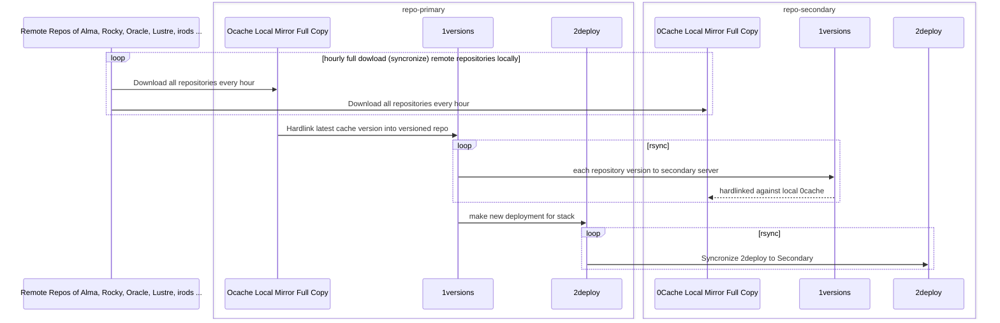
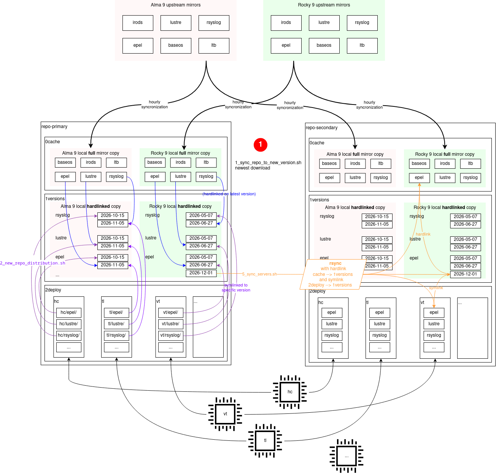

# Repository servers role

## Intro

This role uses `files/patchcord_library/srm.key` key as a default key for the creation of all the cryptographic communication.

## TLDR

**! important !** Downloading, testing and deployment work is done on **primary** server ONLY!

0. Login into primary server and become repo user

    [me@mac ~]$ ssh admin@spring+repo-primary
    [me@repo-primary ~]$ sudo -u repo bash
    [admin@repo-primary ~]$ $ cd /mnt/repos


1. Download packets into cache and automatically generate version with current timestamp

    [repo@repo-primary /mnt/repos]$ # Option 1: for one specific repository
    [repo@repo-primary /mnt/repos]$ ./1_sync_repo_to_new_version.sh -d alma9 -r baseos &
        - Log file: /mnt/repos/logs/scripts/alma9/baseos/20260804-104418
    ( press enter )
    [repo@repo-primary /mnt/repos]$ tail /mnt/repos/logs/scripts/alm/mnt/repos/logs/scripts/alma9/baseos/20260804-104418
            ...
        (2297/2298): zsh-5.8-9.el9.x86_64.rpm            32 MB/s | 2.9 MB     00:00    
        (2298/2298): linux-firmware-20260411-155.5.el9_  38 MB/s | 631 MB     00:16    
          New version created:   /mnt/repos/1versions/alma9/baseos/20260804-104418
        done
    ( press CTRL+c )
    [repo@repo-primary /mnt/repos]$ # Option 2: all repositories for entire distribution
    [repo@repo-primary /mnt/repos]$ ./1_sync_repo_to_new_version.sh -d alma9 &

2. Deploy a specific repository version to a stack

    [repo@repo-primary /mnt/repos]$ # Option 1: for a stack's SPECIFIC repository deploy the specific version
    [repo@repo-primary /mnt/repos]$ ./2_new_repo_distribution.sh -s nb -d alma9 -r perun -v 20260804-112904
    [repo@repo-primary /mnt/repos]$ # Option 2: for a stack's ALL repositories deploy the specific version
    [repo@repo-primary /mnt/repos]$ ./2_new_repo_distribution.sh -s nb -d alma9 -r ALL -v 20260804-112904

3. Cleaning up dead links

    [repo@repo-primary /mnt/repos]$ ./3_clean_deploy_dead_links.sh
    [repo@repo-primary /mnt/repos]$ ./4_clean_unused_versions.sh

4. Syncronize primary server

    [repo@repo-primary /mnt/repos]$ ./5_sync_servers.sh
    ....................Syncing 2deploy ... 
    Successfully finished syncing servers.
    [repo@repo-primary /mnt/repos]$ 

## Daily cache and server syncronization

There is next-to-impossible to make a good syncronization of two servers that
have large versions changes, without waiting a long time for each `rsync` finish`
(which depends on network speed, disk and memory capacity and usage).

Therefore systems CONSTANTLY download cached rpm's from upstream storage. This ensure two things
 - both servers are updated with the same content
 - version-propagation is almost instantaneous

But since the download script must update existing Distributions and Repositories,
while NOT all repositories that we label as 'mirror-capable' (marked with
`repo_server_download: true` in the `groups/all/repos.yml`) should actually donwload
only the ones on the server.

Syncronization script:
 - therefore script parses only existing cached Distros and Repositories, then
   syncronizes only those (`./1_sync_repo_to_new_version.sh -0`)
 - with option `-0`

## Dependecies

This role has dependency on _rsyncd_ role that provides rsync module configuration.
Rsyncd role itself has a dependency on the _sshd_ role.


## Repository settings

The Repository Server role mirrors local repositories based on the `yum_repos` variable in `group_vars/all/repos.yml`.

Deployment Logic
 - Filtering: Only repositories with `repo_server_download: True` are processed.
 - Remote server file structure
   - All repositroy configuration files are stored inside top directory /mnt/repos/dnf/repos.d/
   - Master Config: A `[distribution].conf` file is created at the root of the `repos.d` folder to point to the specific distribution directory.
   - All the Repo Files for specific distrubution are stored inside `/mnt/repos/dnf/repos.d/[distribution]/` (e.g. `.../repos.d/alma9/`).


## Configurations scripts

 - the deployment and configuration scripts are added to `/mnt/repos/` folder
   - `1_xxx.sh` script syncronizes (download) the latest packages and creates
     a new version of this syncronization
   - `2_xxx.sh` script exposes this fresh download to the stack that will be
     using this version
   - `3_xxx.sh` script cleans all the versions that are not used by any stack
     deployments

## Server file storage

The total size of the individual repositories varies, but can be easily 100GB or
more. Therefore to save the space of the each version, the packages are downloaded
to the `0cache/[distribution]` directory. And all the future syncronization
update the entire structure every time - remove the packages which are not in
the original repository any more.

Versions are stored by making copy (on write - reflink) into `1version` folder at
the end of each syncronization. This enforces that the actually used disk space
is reduced to bare minimum.

## Debug

### Getting size and other information for all repositories of specific distribtuion

```
    ssh [admin-usernam]@spring+repo-primary
    sudo -u repo bash
    cd /mnt/repos
    dnf repoinfo --conf /mnt/repos/dnf/repos.d/oracle8.conf
    ...
    Repo-id      : ol8_appstream
    Repo-name    : Oracle Linux 8 Application Stream (x86_64)
    Repo-size    : 312 G
    Available Packages: 10,842
```

## Certificates

Repo servers are currently created in the `patchcord_library`. Therefore the cerfiticates
are stored in the `files/patchcord_library/` folder.

To create and encrypt certificate

```
    openssl req -x509 -newkey rsa:4096 -keyout files/patchcord_library/srm.key -out files/patchcord_library/srm.pem -sha256 -days 3650 -nodes -subj "/C=NL/ST=Groningen/L=Groningen/O=UMCG/OU=GCC/CN="
    ansible-vault encrypt --encrypt-vault-id patchcord_library files/patchcord_library/srm.key
```

## Diagrams

### Sequence diagram



### Detailed diagram


